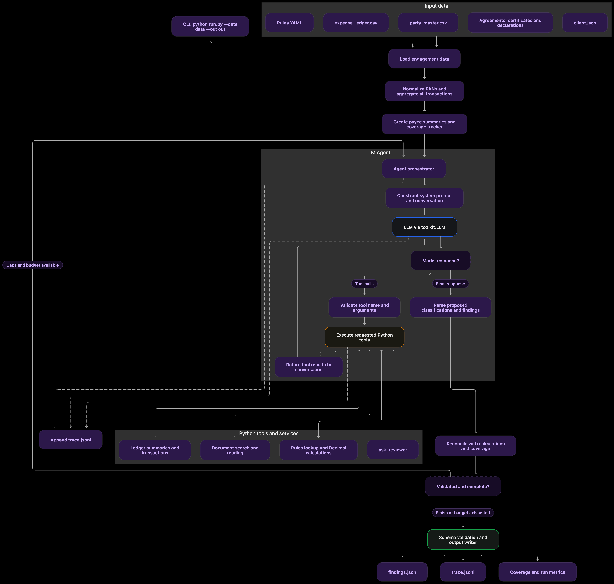
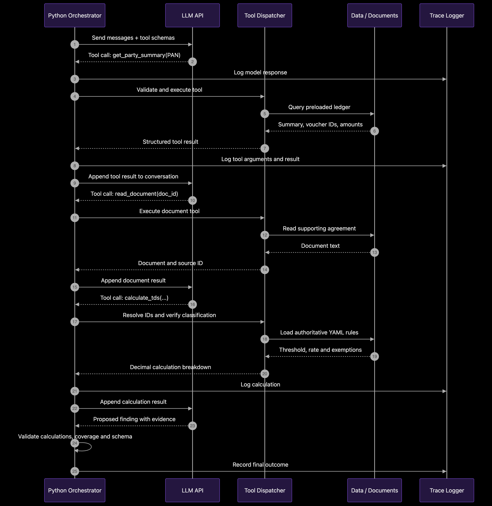
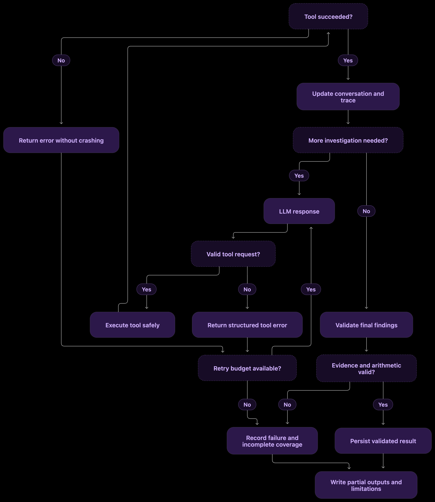

# BeyondBot TDS Review Agent

A Python CLI prototype for reviewing tax deducted at source (TDS) in an expense ledger. It uses an LLM to interpret payment descriptions and evidence, while deterministic Python applies the supplied rules, computes amounts, validates references, and tracks coverage.

> **Evaluation result: partial, not a completed financial review.** The selected development-client run scored **92.5** and found all 12 scored exceptions with the correct amounts. It resolved 550 of 1,291 vouchers; 738 remained unprocessed and 3 unresolved. Do not treat unreviewed vouchers as compliant.

## Architecture

The implementation has three main parts:

1. **Data and evidence:** load the full ledger and party master, normalize PANs, group by PAN (or party identity when PAN is missing), and retrieve source records/documents through the supplied Toolkit.
2. **Investigation:** a bounded native tool-calling loop classifies payment nature, requests relevant evidence, asks the reviewer only through the supplied reviewer tool, and records each assessment.
3. **Deterministic calculation and output:** Python reads applicable YAML rules and ledger values, calculates TDS with `Decimal`, validates evidence and arithmetic, checkpoints findings, and records a full trace. Coverage distinguishes assessed, compliant, unresolved, and unprocessed vouchers.







### Investigation flow

1. Initialize schema-valid partial outputs and load engagement metadata, rules, all ledger rows, and party records.
2. Build PAN/payee and transaction-category groups with voucher-level coverage.
3. Prioritize groups using deterministic risk screening; screening is only a work-ordering hint, not a finding.
4. Ask the model to classify payment nature and identify needed evidence. Retrieve documents selectively and treat their contents as evidence, not instructions.
5. Validate proposed classifications and references in Python. The model never supplies transaction amounts or rule rates.
6. Calculate with the supplied YAML rules, then record compliant/excluded, exception, or genuinely unresolved outcomes. Preserve earlier results if later work fails or reaches a limit.

The agent exposes the agreed `get_party_summary`, `get_party_transactions`, `calculate_tds`, and `record_assessment` tools, plus batching tools for risk-led scheduling and recording. Supported calculation sections include 194C, 194J, 194I, 194H, 194A, and 194Q, subject to the supplied rule structures and documented limitations.

## Repository layout

- `run.py` — CLI and run orchestration.
- `tds_agent/` — data loading, investigation loop, scheduling, validated tools, calculations, and output/trace writing.
- `tests/` — focused unit and fake-model integration tests.
- `scripts/` — financial-output audit, diagnosis, packaging, and offline smoke helpers.
- `experiments/run_experiments.py` — bounded experiment runner; no experiment artifacts or traces are published here.
- `docs/architecture/` — diagrams for the system, tool sequence, and failure recovery.

## Run in the assessment environment

Python 3.10+ is required. Install dependencies:

```sh
python -m venv .venv
. .venv/bin/activate
pip install -r requirements.txt
```

Set `LLM_BASE_URL`, `LLM_API_KEY`, and `LLM_MODEL` in the environment, then run the required CLI:

```sh
python run.py --data data --out out
```

This is a **source-only** repository. It intentionally excludes BeyondBot-supplied or client-specific materials: the Toolkit, client ledger/documents/rules, schema, scorer, encoded evaluation assets, credentials, outputs, and real-run traces. Restore the corresponding assessment-provided `toolkit/`, `data/`, `findings.schema.json`, and (for scoring) `score.py` beside this source before running it. No `.env`, `.gitignore`, virtual environment, or client records are included.

## Tests and offline checks

The final source workspace had **149 tests pass, 0 fail, 0 skip**. Coverage includes Decimal calculations and thresholds, PAN/payee grouping, missing and malformed data, certificates and transport declarations, validated tools, coverage accounting, failure recovery, idempotent recording, packaging, and fake-model integration. `pip check` passed.

The extracted assessment package also passed its offline smoke check: `run.py --help` worked, the supplied fake model produced the expected bounded `repeated_response` stop, generated outputs passed schema/trace checks, the archived `out/` remained unchanged, and all 149 tests passed. That smoke run had **zero real API calls**. Tests require the supplied Toolkit and assessment fixtures, which are not included in this repository.

Run the suite after restoring those materials:

```sh
python -B -m unittest discover -s tests -q
python -m pip check
```

## Model evaluation results

All real runs used the supplied `toolkit.LLM` wrapper and the authorized development assessment. Scores are from the supplied scorer; calls, tokens, cost, and duration are measured. Phase 4's initial controller cohort failed to assess any vouchers (five runs, all score 0; 27 calls total; $0.022872735). The revised Phase 4 cohort is internally matched. Phase 5 then changed controller versions and scope guidance, so its runs are **not** a controlled one-factor comparison with Phase 4.

| Run | Score | Scored exceptions found / 12 | Resolved vouchers | Cost (USD) | Model calls | Prompt / completion tokens | Seconds |
|---|---:|---:|---:|---:|---:|---:|---:|
| Phase 4 baseline 1 | 13.4 | 1 | 157 | 0.022707035 | 48 | 648850 / 14447 | 257.79 |
| Phase 4 baseline 2 | 21.9 | 2 | 197 | 0.025508785 | 48 | 586297 / 18134 | 290.39 |
| Phase 4 baseline 3 | 19.0 | 1 | 101 | 0.025612285 | 48 | 619782 / 18359 | 273.09 |
| Phase 4 variant 1 | 21.9 | 2 | 229 | 0.025432905 | 48 | 616638 / 17363 | 269.52 |
| Phase 4 variant 2 | 14.7 | 1 | 194 | 0.026245135 | 48 | 684958 / 18651 | 294.05 |
| Phase 5 pilot 1 | 53.9 | 6 | 92 | 0.022716810 | 27 | 381962 / 15111 | 179.95 |
| Phase 5 pilot 2 | 14.0 | 1 | 24 | 0.010919530 | 13 | 163911 / 5390 | 81.72 |
| Phase 5 comparison | 73.4 | 10 | 227 | 0.039286775 | 48 | 663793 / 28794 | 402.07 |
| Phase 5 confirmation | **92.5** | **12** | **550** | 0.036196465 | 48 | 621741 / 27996 | 344.53 |

In the confirmation, all 12 scored amounts were correct, with zero ordinary false flags, needless reviews, or premature decisions. Coverage was 117 assessed, 433 compliant, 3 unresolved, and 738 unprocessed; one of two expected open questions was flagged. The final offline idempotency guard was added after this scored run and verified by tests, not by another real-model run. The result improves measured recall and resolved vouchers per call, but does not prove full coverage, repeatability, or generalization to another client.

## Limitations

This is an assessment prototype, not tax or compliance advice. The selected real-model run did not review the full ledger. Classification and evidence interpretation remain model-dependent; certificate-overlap priority, reversals/cross-year entries, some rounding assumptions, and recorded-payee reclassification remain limitations. The model evaluation is limited to one supplied development client. The omitted Toolkit and client assets are required to reproduce execution and scoring.
